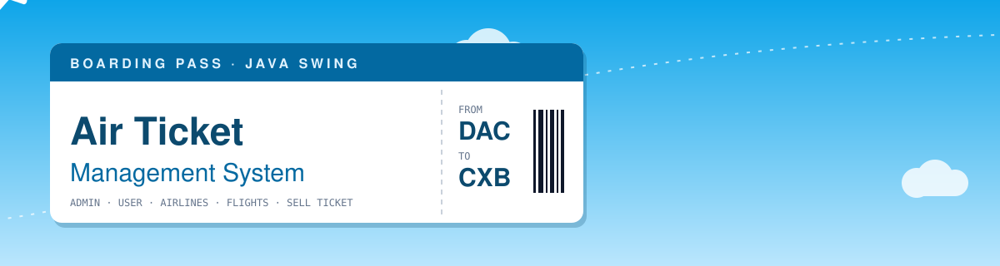

<p align="center">
  
</p>

# ✈️ Air Ticket Management System

A desktop application written in **Java Swing** for running a small travel agency's ticket desk. Admins manage airlines, airports, flights and users. Users sign up, browse flights and sell tickets.

## Features

| Area | What it does |
|---|---|
| **Login portal** | Separate admin and user logins, plus user sign-up |
| **Admin panel** | Add airlines, flights and users; view airline, airport, flight and user lists |
| **User panel** | View airlines, airports and flights; sell tickets |
| **Storage** | Plain text files in [`file/`](file/), so no database is needed |

## Project structure

```text
Air-Ticket-Management-System/
├── src/AirTicketManagementSystem/   # Swing screens (HomePage, LoginPortal, AdminPanel, UserPanel, SellTicket, …)
├── file/                            # Text-file "database": airlines, airports, flights, users, sales
└── img/                             # Icons and GIFs used by the UI
```

## Run it

Requires a JDK (8 or newer). Run these from the repository root so the app can find `file/` and `img/`:

```bash
javac -d out src/AirTicketManagementSystem/*.java
java -cp out AirTicketManagementSystem.Main
```

Or open the folder in IntelliJ IDEA, Eclipse or NetBeans and run `Main.java`.

> **Note:** Login details are stored in plain text under `file/`. That is fine for a class project, but change them and don't reuse real passwords.
